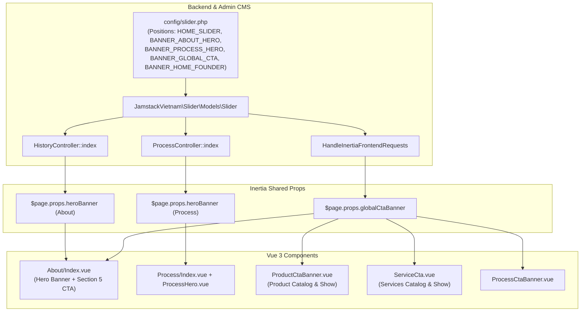

# Design: Dynamic Banners & Global CTA Integration

## 1. Kiến trúc Tổng thể (Architecture Diagram)



---

## 2. Chi tiết Thiết kế Backend

### 2.1. Cấu hình Slider (`config/slider.php`)
```php
return [
    'positions' => [
        'HOME_SLIDER' => [
            'title' => 'Slider trang chủ',
            'value' => 'HOME_SLIDER',
            'banner' => false,
        ],
        'BANNER_ABOUT_HERO' => [
            'title' => 'Hero Banner trang Giới thiệu',
            'value' => 'BANNER_ABOUT_HERO',
            'banner' => true,
        ],
        'BANNER_PROCESS_HERO' => [
            'title' => 'Hero Banner trang Quy trình',
            'value' => 'BANNER_PROCESS_HERO',
            'banner' => true,
        ],
        'BANNER_GLOBAL_CTA' => [
            'title' => 'Banner CTA kêu gọi tư vấn chân trang',
            'value' => 'BANNER_GLOBAL_CTA',
            'banner' => true,
        ],
        'BANNER_HOME_FOUNDER' => [
            'title' => 'Banner Câu chuyện Founder trang chủ',
            'value' => 'BANNER_HOME_FOUNDER',
            'banner' => true,
        ],
    ]
];
```

### 2.2. HistoryController (`app/Http/Controllers/Frontend/HistoryController.php`)
```php
use JamstackVietnam\Slider\Models\Slider;
...
$data = Cache::remember('history_index_' . current_locale(), 3600, function () {
    $posts = Post::query()
        ->active()
        ->orderByHomePosition()
        ->orderBy('id', 'desc')
        ->take(3)
        ->get()
        ->map(fn($item) => $item->transform());

    $heroBanner = Slider::getByPosition('BANNER_ABOUT_HERO');

    return [
        'posts' => $posts,
        'heroBanner' => $heroBanner,
    ];
});
```

### 2.3. ProcessController (`app/Http/Controllers/Frontend/ProcessController.php`)
Tạo mới file Controller:
```php
<?php

namespace App\Http\Controllers\Frontend;

use Inertia\Inertia;
use Illuminate\Routing\Controller;
use JamstackVietnam\Slider\Models\Slider;
use Illuminate\Support\Facades\Cache;

class ProcessController extends Controller
{
    public function index()
    {
        try {
            $data = Cache::remember('process_index_' . current_locale(), 3600, function () {
                $heroBanner = Slider::getByPosition('BANNER_PROCESS_HERO');

                return [
                    'heroBanner' => $heroBanner,
                ];
            });

            if (request()->wantsJson()) {
                return response()->json($data);
            }

            return Inertia::render('Process/Index', $data);
        } catch (\Throwable $th) {
            report($th);
            return abort(500);
        }
    }
}
```

### 2.4. Định tuyến (`routes/frontend.php`)
Cập nhật route quy trình:
```php
Route::get(Lang::uri('quy-trinh'), [ProcessController::class, 'index'])->name('process.index');
Route::get('ve-chung-toi', [HistoryController::class, 'index']);
```

### 2.5. Middleware Inertia (`app/Http/Middleware/HandleInertiaFrontendRequests.php`)
Nạp `BANNER_GLOBAL_CTA`:
```php
$globalCtaBanner = Slider::getByPosition('BANNER_GLOBAL_CTA');
...
return [
    'prizes' => $prizes,
    'learning_env' => $learning_env,
    'footer_courses' => $footerCourses,
    'members' => $members,
    'policies' => $policies,
    'faqs' => $faqs,
    'globalCtaBanner' => $globalCtaBanner,
    'banner' => [
        'banner_home' => $banner_home,
        'BANNER_GLOBAL_CTA' => $globalCtaBanner,
        'global_cta' => $globalCtaBanner,
    ]
];
```
Và truyền vào mảng `$share`:
```php
'globalCtaBanner' => $layoutData['globalCtaBanner'] ?? null,
```

---

## 3. Chi tiết Thiết kế Frontend Binding

### 3.1. Trang Giới thiệu (`About/Index.vue`)
- Nhận prop: `heroBanner: { type: Object, default: () => null }`.
- Sử dụng computed hoặc inline binding với fallback Figma:
  - Title: `heroBanner?.title || 'ĐƯA SÁNG TẠO VƯỢT RA KHỎI MÀN HÌNH'`
  - Subtitle: `heroBanner?.subtitle || 'Giới thiệu về HH Maker'`
  - Description: `heroBanner?.description || 'Chúng tôi kết nối nghệ thuật 3D với công nghệ chế tác hiện đại, để một ý tưởng sơ khai có thể trở thành sản phẩm bạn cầm trên tay.'`
  - Image: `heroBanner?.image?.url || '/assets/images/about/hero-about.png'`
  - Alt: `heroBanner?.image?.alt || 'Xưởng chế tác 3D HH Maker'`
- Section 5 CTA kết nối với `$page.props.globalCtaBanner` (kèm fallback Figma).

### 3.2. Trang Quy trình (`Process/Index.vue` & `ProcessHero.vue`)
- `Process/Index.vue` nhận prop `heroBanner` và chuyển tiếp: `<ProcessHero :banner="heroBanner" />`.
- `ProcessHero.vue` nhận prop `banner: { type: Object, default: () => null }`:
  - Category: `banner?.subtitle || 'QUY TRÌNH LÀM VIỆC'`
  - Title: `banner?.title || 'RÕ RÀNG TỪNG BƯỚC\nCHỈN CHU TỪNG SẢN PHẨM'`
  - Description: `banner?.description || 'Từ ý tưởng ban đầu đến thành phẩm hoàn thiện...'`
  - Image: `banner?.image?.url || '/images/process/process_hero_bg.png'`
  - Alt: `banner?.image?.alt || 'HH Maker Quy trình làm việc'`

### 3.3. Các Component CTA Chân Trang
- `ProductCtaBanner.vue`, `ServiceCta.vue`, `ProcessCtaBanner.vue`:
  - Khai báo computed `ctaBanner`:
    ```javascript
    const page = usePage()
    const cta = computed(() => {
        return props.banner || page.props.value?.globalCtaBanner || page.props.value?.data?.banner?.BANNER_GLOBAL_CTA || null
    })
    ```
  - Bind Title, Description, Button Text (`primary_cta_text` hoặc `'Nhận tư vấn ngay'`), Link (`primary_cta_link` hoặc `route('contact')`).
  - Giữ vững style gradient Cobalt Blue: `background: linear-gradient(90deg, #2970FF 0%, #00359E 89%);`.
