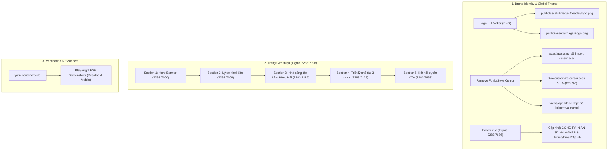

# Design: Hoàn thiện Dứt điểm Nhận diện Thương hiệu HH Maker & Trang Giới thiệu

## Kiến trúc & Luồng Thực thi

## Chi tiết Triển khai

### 1. Logo Thương hiệu
- Ghi đè file `logo-hhmaker.png` (278x94) vào `public/assets/images/header/logo.png` và `public/assets/images/logo.png`.
- Tỷ lệ hiển thị trong Header (`h-8 lg:h-9 w-auto object-contain`) và Footer (`h-10 w-auto object-contain`).

### 2. Dọn Dẹp Cursor Cũ
- Loại bỏ hoàn toàn các selector `cursor: url('/assets/svg/GS-pen.svg')` và biến `--cursor-url`.
- Trình duyệt sẽ dùng con trỏ mặc định sạch sẽ, tăng độ tin cậy theo triết lý Anti-UI-Slop.

### 3. Cấu trúc 5 Section Trang Giới thiệu (`About/Index.vue`)
- **Section 1 - Hero**:
  - Background: `/assets/images/about/hero-about.png` (Mask group 1279x616, bo góc 16px).
  - Badge: "Giới thiệu về HH Maker" (#D1E0FF, nền #2970FF/20).
  - Title: "ĐƯA SÁNG TẠO VƯỢT RA KHỎI MÀN HÌNH" (38px Bold, color #FAFAFA).
  - Rotating stamp: SVG vòng tròn xoay `animate-[spin_15s_linear_infinite]` với chữ `FROM IDEAS TO REALITY - FROM IDEAS TO REALITY -`, trung tâm là icon `arrow-up-right`.
- **Section 2 - Lý do khởi đầu**:
  - Layout 2 cột: Cột trái (360px) chứa badge "Vì sao HH Maker ra đời?" (#84ADFF) và tiêu đề H2 "TỪ ĐAM MÊ ĐẾN MỘT SỨ MỆNH" (38px bold). Cột phải (672px) chứa 2 đoạn văn về sứ mệnh.
- **Section 3 - Nhà sáng lập**:
  - Layout 2 cột: Cột trái ảnh chân dung Founder Lâm Hồng Hải `/assets/images/about/founder.png` với khung gradient xanh `#00359E -> #2970FF` và nhãn "LÂM HỒNG HẢI - Founder HH Maker".
  - Cột phải: Badge "Chia sẻ từ Nhà sáng lập HH Maker" (#84ADFF), tiêu đề H2 "Mỗi ý tưởng đều xứng đáng có một hình hài" (32px bold), 3 đoạn thư tâm huyết và chữ ký "Trân trọng từng ý tưởng - Tận tâm với từng thành phẩm." (#FAFAFA, semi-bold).
- **Section 4 - Triết lý chế tác**:
  - Tiêu đề phụ: "Cách HH Maker thực hiện trong từng dự án" (#84ADFF).
  - Tiêu đề chính: "CÔNG NGHỆ TẠO HÌNH - SỰ TỈ MỈ TẠO DẤU ẤN" (38px bold #FAFAFA).
  - Lưới 3 card viền #5D6B98, bo góc 12px, padding 28px:
    * Card 1: Icon `/assets/images/about/lightbulb.svg`, Tiêu đề "Thấu hiểu từng ý tưởng", Nội dung "Chúng tôi lắng nghe câu chuyện, nhu cầu sử dụng và mong muốn của bạn để tìm ra hướng thiết kế phù hợp, trước khi bắt đầu những nét phác thảo đầu tiên."
    * Card 2: Icon `/assets/images/about/scan-line.svg`, Tiêu đề "Chăm chút từng chi tiết", Nội dung "Từ hình khối, tỉ lệ, vật liệu đến quá trình in và hoàn thiện, sản phẩm đều được chăm chút để hài hòa về hình thức và phù hợp với cách sử dụng thực tế."
    * Card 3: Icon `/assets/images/about/fingerprint.svg`, Tiêu đề "Giữ trọn dấu ấn riêng", Nội dung "Phong cách của bạn được thể hiện qua màu sắc, đường nét và những chi tiết cá nhân hóa. HH Maker kết nối những yếu tố ấy để truyền tải đúng tinh thần bạn muốn gửi gắm."
- **Section 5 - Kết nối dự án**:
  - Banner nền gradient `linear-gradient(90deg, #2970FF 0%, #00359E 89%)`, bo góc 16px.
  - Tiêu đề: "Ý tưởng của bạn, bước tiếp theo của chúng ta." (32px bold #FAFAFA).
  - Mô tả: "Chia sẻ mong muốn của bạn. HH Maker sẽ cùng bạn tìm hướng thiết kế và gia công phù hợp."
  - Nút "Nhận tư vấn ngay" (nền #F5F8FF, chữ #111322 bold, bo góc 8px), liên kết sang `/lien-he`.

### 4. Footer Chuẩn Hóa (`Footer.vue`)
- Tiêu đề công ty: "CÔNG TY IN ẤN 3D HH MAKER".
- Địa chỉ: "Số 65 đường số 9, khu dân cư Hương Lộ 5, Phường An Lạc, Thành phố Hồ Chí Minh".
- Hotline: "0906636425" (href `tel:0906636425`).
- Emails: "info@hhmaker.vn" và "lamhonghai123@gmail.com".
- Năm bản quyền động: `© {{ currentYear }} HH MAKER`.
