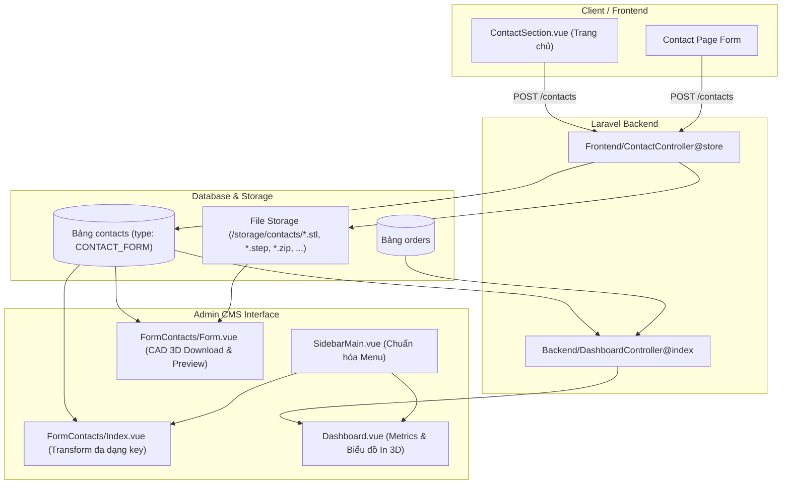

# Technical Design: Chuẩn hóa Admin CMS cho Xưởng In 3D HH Maker

## 1. Kiến trúc Tổng thể



---

## 2. Chi tiết Thiết kế Kỹ thuật

### 2.1. Chuẩn hóa Danh sách Báo giá (`FormContacts/Index.vue`)

- **Cấu hình Table Columns**:
  ```javascript
  [
      'id',
      {
          field: 'name',
          label: 'Họ và tên',
          transform: (row) => {
              const d = row.data || row.data_contact || {}
              return d['Họ và tên'] || d['Họ tên'] || d.name || d.full_name || '-'
          },
      },
      {
          field: 'phone',
          label: 'Số điện thoại',
          transform: (row) => {
              const d = row.data || row.data_contact || {}
              return d['Số điện thoại'] || d['Số ĐT'] || d.phone || d.telephone || '-'
          },
      },
      {
          field: 'email',
          label: 'Email',
          transform: (row) => {
              const d = row.data || row.data_contact || {}
              return d['Email'] || d.email || row.data_contact?.email || '-'
          },
      },
      {
          field: 'service',
          label: 'Dịch vụ',
          transform: (row) => {
              const d = row.data || row.data_contact || {}
              const s = d['Dịch vụ quan tâm'] || d['Dịch vụ'] || d.service || d.service_title
              if (typeof s === 'object' && s !== null) {
                  return s.title || s.name || '-'
              }
              return s || '-'
          },
      },
      'status',
      'created_at',
  ]
  ```

### 2.2. Chi tiết Báo giá & Tải file CAD (`FormContacts/Form.vue`)

- **Loại bỏ**: Các khối `v-if="form.data_contact.resource"` và `v-if="form.data_contact.course"`.
- **Hiển thị thông tin chính**:
  - Trích xuất dữ liệu tổng hợp từ `form.data_contact` hoặc `form.data`:
    - Tên khách hàng: `Họ và tên` / `name`
    - Số điện thoại: `Số điện thoại` / `phone`
    - Email: `Email` / `email`
    - Dịch vụ yêu cầu: `Dịch vụ quan tâm` / `Service.title` / `service`
    - Chi tiết / Yêu cầu gia công: `Nội dung cần hỗ trợ` / `note` / `customer_note`
- **Xử lý Tệp đính kèm (`files` / `images`)**:
  - Tách tệp thành 2 nhóm:
    1. **Ảnh xem trước (`previewImages`)**: Phần mở rộng `.jpg`, `.jpeg`, `.png`, `.webp`, `.gif`, `.svg`.
    2. **Mô hình CAD & Tệp nén (`cadFiles`)**: Phần mở rộng `.stl`, `.obj`, `.step`, `.stp`, `.3mf`, `.zip`, `.rar`, `.7z`, `.iges`, `.igs`, `.dwg`, `.dxf`, `.blend`, `.ply`, `.pdf` hoặc các file không phải ảnh.
  - Với nhóm CAD: Render danh sách card gồm:
    - Icon 3D / Box / Archive chuyên nghiệp.
    - Tên file hoặc phần mở rộng in hoa (Badge: `STL`, `STEP`, `OBJ`...).
    - Nút bấm `<a>` với `target="_blank"` và `download`, liên kết tới `staticUrl(file.path)`.

### 2.3. Cập nhật Submit Liên hệ Trang chủ (`ContactSection.vue`)

- URL gửi dữ liệu:
  ```javascript
  const postUrl = typeof route === 'function' ? route('contact.store') : '/contacts'
  const payload = {
      type: 'CONTACT_FORM',
      name: this.form.name,
      email: this.form.email,
      phone: this.form.phone,
      data: {
          'Họ và tên': this.form.name,
          'Số điện thoại': this.form.phone,
          'Email': this.form.email,
          'Nội dung cần hỗ trợ': this.form.note,
      },
  }
  await window.axios.post(postUrl, payload)
  ```

### 2.4. Sidebar Menu (`SidebarMain.vue`)

- Cập nhật các khối menu:
  - Thêm `<Link :href="route('admin.product-categories.index')">`
  - Thêm `<Link :href="route('admin.orders.index')">`
  - Xóa các thẻ `<Link>` của `admin.learning-environments.index`, `admin.prizes.index`, `admin.feedback.index`, `admin.projects.index`, `admin.project-categories.index`.

### 2.5. Backend Dashboard (`DashboardController.php`)

- Truy vấn số liệu báo giá in 3D:
  ```php
  // Báo giá in 3D
  $todayQuotes = Contact::where('type', 'CONTACT_FORM')->whereDate('created_at', $today)->count();
  $thisMonthQuotes = Contact::where('type', 'CONTACT_FORM')->where('created_at', '>=', $thisMonth)->count();
  $lastMonthQuotes = Contact::where('type', 'CONTACT_FORM')->whereBetween('created_at', [$lastMonth, $thisMonth])->count();
  $quoteGrowth = $lastMonthQuotes > 0 ? (($thisMonthQuotes - $lastMonthQuotes) / $lastMonthQuotes) * 100 : 0;

  // Thống kê phân loại dịch vụ
  $allContacts = Contact::where('type', 'CONTACT_FORM')->get();
  $serviceDistribution = [
      'Gia công 3D' => 0,
      'Thiết kế 3D' => 0,
      'Làm đồ custom' => 0,
      'Khác' => 0,
  ];
  // Phân loại dựa trên chuỗi regex hoặc từ khóa trong 'Dịch vụ quan tâm' / 'Service'
  ```
- Biểu đồ xu hướng báo giá theo các tháng trong năm (`quoteStatsByMonth`).
- Danh sách 5-10 yêu cầu báo giá in 3D gần nhất (`recentQuotes`).

### 2.6. Dashboard View (`Dashboard.vue`)

- Cấu trúc giao diện mới:
  - Hàng 1: 4 Metric Cards:
    1. Báo giá in 3D hôm nay
    2. Tổng báo giá tháng này & Dự báo
    3. Tăng trưởng báo giá MoM (%)
    4. Tỷ lệ gia công in 3D / Tỷ lệ chuyển đổi đơn
  - Hàng 2:
    - Cột 8: Biểu đồ cột xu hướng Báo giá in 3D theo tháng/quý (`quoteChartData`).
    - Cột 4: Biểu đồ phân bổ tỷ lệ dịch vụ in 3D (Pie / Doughnut / Polar hoặc Horizontal Bar).
  - Hàng 3: Bảng danh sách "Yêu cầu báo giá in 3D mới nhất" hiển thị đầy đủ tên khách hàng, số điện thoại, dịch vụ, trạng thái và nút xem chi tiết nhanh.
