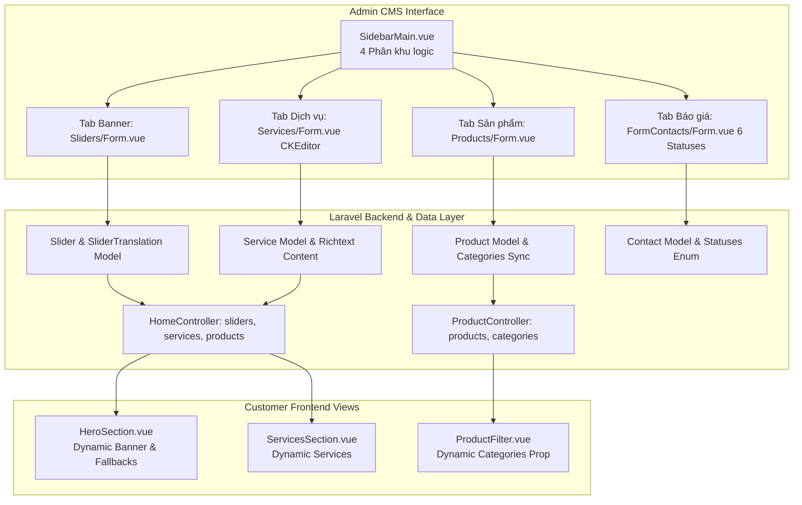

# Technical Design: Refactor Admin CMS Core Tabs & Streamlined Sidebar

## 1. Kiến trúc tổng thể (Architecture Overview)



## 2. Chi tiết Thành phần Kỹ thuật (Component Implementation Details)

### 2.1 Sidebar CMS (`resources/Backend/js/Components/SidebarMain.vue`)
- Bọc toàn bộ các menu items vào các section header trực quan:
  ```html
  <div class="px-6 pt-4 pb-1 text-[11px] font-bold text-gray-400 uppercase tracking-wider">
      📊 BẢNG ĐIỀU KHIỂN
  </div>
  <!-- Dashboard Link -->

  <div class="px-6 pt-4 pb-1 text-[11px] font-bold text-gray-400 uppercase tracking-wider">
      🟢 VẬN HÀNH XƯỞNG IN 3D
  </div>
  <!-- Contacts, Products, Product Categories, Services -->

  <div class="px-6 pt-4 pb-1 text-[11px] font-bold text-gray-400 uppercase tracking-wider">
      🎨 NỘI DUNG & THƯƠNG HIỆU
  </div>
  <!-- Sliders, Posts, Post Categories, Policies -->

  <div class="px-6 pt-4 pb-1 text-[11px] font-bold text-gray-400 uppercase tracking-wider">
      ⚙️ HỆ THỐNG & CẤU HÌNH
  </div>
  <!-- Users, Email Templates, Files, Settings, Admins, Roles -->
  ```
- Đồng bộ hóa với `SidebarItems.vue` để loại bỏ các menu trùng lặp bên ngoài `SidebarMain`.
- Loại bỏ các route đã deprecated: `admin.orders.*`, `admin.members.*`, `admin.support-info.*`, `admin.faqs.*`.

### 2.2 Tab 1: Banner & Hero Slider
- Database Migration: Tạo migration bổ sung `subtitle`, `primary_cta_text`, `primary_cta_link`, `secondary_cta_text`, `secondary_cta_link` vào bảng `slider_translations` (hoặc lưu trong `custom_fields` có schema migration bảo đảm tính tương thích).
- Model `Slider.php` & `SliderTranslation.php`: Bổ sung các trường vào `$translatedAttributes` và `transform()`.
- Component `Sliders/Form.vue`: Bổ sung các `<Field>` nhập liệu phụ đề và các nút CTA.
- Frontend `HomeController.php`, `Home/Index.vue`, `HeroSection.vue`: Truyền và hiển thị dynamic banner kèm fallback.

### 2.3 Tab 2: Sản phẩm in 3D
- Database Migration: Bổ sung các cột `price`, `compare_at_price`, `print_technology`, `material`, `lead_time` vào bảng `products`.
- Model `Product.php`:
  + Thêm vào `$fillable`.
  + Thêm vào `transform()`.
  + Kích hoạt `$model->saveCategories($model);` trong hook `static::saved`.
- Component `Products/Products/Form.vue`:
  + Thêm `<Field type="select_multiple" name="categories" ...>` kết nối tới `ProductCategory`.
  + Thêm các ô nhập `price`, `compare_at_price` (kiểu số).
  + Thêm thẻ phân khu thông số kỹ thuật in 3D: Công nghệ in, Vật liệu in, Lead time gia công.

### 2.4 Tab 3: Danh mục & Bộ lọc
- Component `ProductFilter.vue`:
  + Khai báo `props: { categories: { type: Array, default: () => [] } }`.
  + Viết computed `displayCategories` ưu tiên lấy danh mục từ `categories` prop, nếu rỗng thì fallback về `defaultCategories`.
  + Cập nhật template v-for lặp qua `displayCategories`.
- `Product/Index.vue`: Đảm bảo prop `categories` được khai báo và truyền đúng vào `<ProductFilter>`.

### 2.5 Tab 4: Dịch vụ In 3D
- Component `Services/Form.vue`:
  + Chuyển đổi `<Field v-model="form.content">` từ `type: 'text'` thành `type: 'richtext'` với nhãn "Nội dung chi tiết".
- Controller `HomeController.php`:
  + Nạp `Service::query()->active()->sortByPosition()->get()->map(fn($s) => $s->transform())` vào mảng `$data['services']`.
- Frontend `Home/Index.vue` & `ServicesSection.vue`:
  + Nhận prop `services` và truyền sang `ServicesSection`.

### 2.6 Tab 5: Báo giá & Yêu cầu in 3D
- Model `Contact.php`:
  + Chuẩn hóa hằng số trạng thái: `STATUS_NEW` ('NEW'), `STATUS_CHECKING_CAD` ('CHECKING_CAD'), `STATUS_QUOTED` ('QUOTED'), `STATUS_PROCESSING` ('PROCESSING'), `STATUS_COMPLETED` ('COMPLETED'), `STATUS_IS_SPAM` ('IS_SPAM').
  + Cập nhật `STATUS_LIST` và `getFormattedStatusAttribute()`.
- Database Migration: Bổ sung `internal_notes` (text nullable) và `estimated_price` (decimal 15,2 nullable) vào bảng `contacts`.
- Model `Contact.php`: Thêm vào `$fillable`, `$casts`, và đồng bộ tự động vào `data`.
- Component `FormContacts/Form.vue`:
  + Bổ sung ô nhập "Giá trị báo giá tạm tính (VNĐ)" (`estimated_price`).
  + Bổ sung ô nhập "Ghi chú nội bộ (Internal Notes)" (`internal_notes`).
