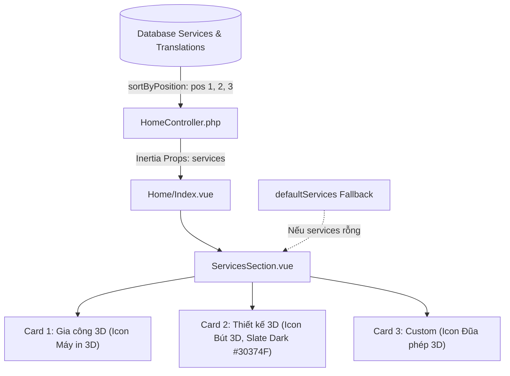

# Technical Design: Đồng bộ thứ tự và nội dung Section "Tổng quan về dịch vụ" Trang chủ

## Context

Trên Trang chủ HH Maker (`resources/Frontend/js/Pages/Home/Components/ServicesSection.vue`), section "TỔNG QUAN VỀ DỊCH VỤ" hiển thị 3 card dịch vụ. Dữ liệu này được cung cấp từ 2 nguồn:
1. **Dữ liệu động từ Backend**: Truyền qua Inertia props từ `HomeController::index()`:
   ```php
   $services = Service::query()->active()->sortByPosition()->get()->map(fn($s) => $s->transform());
   ```
   Hàm `sortByPosition()` sắp xếp theo cột `position ASC`.
2. **Dữ liệu tĩnh dự phòng (Fallback)**: Khai báo trong `defaultServices` của `ServicesSection.vue`.
3. **Logic Style Figma Node 2261:5549**: Thẻ ở giữa (vị trí thứ 2, `index === 1`) được quy định nền tối Slate Dark `linear-gradient(180deg, #111322 20%, #30374F 100%)`, hover shadow `#30374F/50`. Hai thẻ hai bên (`index === 0` và `index === 2`) sử dụng nền viền xanh `linear-gradient(180deg, #111322 20%, #2970FF 94%)`.

Tuy nhiên, hiện tại thứ tự giữa Figma, Seeder database và `defaultServices` chưa đồng nhất:
- `defaultServices` đặt thẻ "Thiết kế 3D" ở index 0 và "Gia công 3D" ở index 1, làm cho thẻ giữa vô tình bị gán cho "Gia công 3D" thay vì "Thiết kế 3D".
- Database seeder đặt `thiet-ke-3d` position 1, `gia-cong-3d` position 2.
- Hình 2 Figma chuẩn yêu cầu:
  * Vị trí 1: **Gia công 3D** (Icon máy in 3D)
  * Vị trí 2: **Thiết kế 3D** (Icon bút 3D, nền Slate Dark `#30374F`)
  * Vị trí 3: **Custom** (Icon đũa phép/phụ kiện 3D)

## Goals / Non-Goals

**Goals:**
- Đồng bộ chuẩn xác 100% thứ tự 3 thẻ dịch vụ trên Trang chủ theo đúng Figma Hình 2 từ Database, Seeder, Backend API đến Frontend Vue.
- Cập nhật văn bản mô tả mới song ngữ (VI & EN) cho cả 3 thẻ dịch vụ:
  * Gia công 3D: "Hiện thực hóa mô hình bằng công nghệ in 3D, chú trọng độ chính xác và chất lượng sản phẩm" (VI) / "Realizing models with 3D printing technology, focusing on precision and product quality." (EN)
  * Thiết kế 3D: "Biến ý tưởng thành mô hình 3D chi tiết, kết hợp tính thẩm mỹ và khả năng chế tác thực tế." (VI) / "Transforming ideas into detailed 3D models, blending aesthetics with practical manufacturability." (EN)
  * Custom: "Thiết kế và chế tác theo yêu cầu, tạo nên những món đồ độc đáo mang dấu ấn riêng của bạn." (VI) / "Custom design and manufacturing on demand, crafting unique pieces with your signature touch." (EN)
- Tinh chỉnh tên dịch vụ thứ 3 thành "Custom" trên giao diện.
- Giữ nguyên toàn bộ cấu trúc slug và URL hiện tại.
- Vượt qua 100% các bài test E2E Playwright.

**Non-Goals:**
- Không thay đổi slug URL (`/dich-vu/gia-cong-3d`, `/dich-vu/thiet-ke-3d`, `/dich-vu/lam-do-custom`).
- Không tạo migration phá hủy hoặc thay đổi schema database.
- Không can thiệp vào các section khác trên Trang chủ (Hero, Carousel sản phẩm, Process, Brand Story, Liên hệ).
- Không sửa đổi cấu trúc bài viết chi tiết tại trang `/dich-vu/{slug}` ngoài việc đồng bộ tên gọi/mô tả ngắn.

## Decisions

### Quyết định 1: Bảo tồn Slug kỹ thuật `lam-do-custom`
- **Lý do**: URL `/dich-vu/lam-do-custom` (và `/en/services/lam-do-custom`) đã được thiết lập trong router Ziggy, sitemap và kiểm thử tự động. Việc chỉ đổi nhãn hiển thị từ "Làm đồ custom" thành "Custom" mà giữ nguyên slug giúp duy trì tính ổn định của hệ thống, tránh nguy cơ lỗi 404 và ảnh hưởng đến SEO.
- **Giải pháp thay thế đã loại bỏ**: Đổi slug database thành `custom` -> Đòi hỏi phải cập nhật lại toàn bộ bảng route, thêm redirect 301, cập nhật các breadcrumb và e2e test, rủi ro cao không cần thiết.

### Quyết định 2: Cập nhật Position và Dữ liệu trong Database Seeder theo cơ chế `updateOrCreate`
- **Lý do**: `HomeController` lấy danh sách dịch vụ thông qua `Service::query()->active()->sortByPosition()->get()`. Do đó, `position` trong DB quyết định thứ tự thực tế khi website vận hành:
  * `gia-cong-3d`: `position = 1`
  * `thiet-ke-3d`: `position = 2`
  * `lam-do-custom`: `position = 3`
- Seeder sử dụng `updateOrCreate` / `updateOrInsert` an toàn, kèm theo lệnh xóa cache `Service::clearServiceCaches()` và `cache()->flush()`.
- **Giải pháp thay thế đã loại bỏ**: Chỉ sửa code Vue `defaultServices` -> Không triệt để vì khi DB trả về dữ liệu qua props Inertia, thứ tự cũ trong DB sẽ đè lên giao diện.

### Quyết định 3: Đồng bộ `defaultServices` và Gradient Helper trong `ServicesSection.vue`
- **Lý do**: Đảm bảo trải nghiệm render tĩnh / fallback đồng bộ tuyệt đối với logic của Figma:
  * `defaultServices[0]`: Gia công 3D (`slug: 'gia-cong-3d'`), gradient xanh `#2970FF`.
  * `defaultServices[1]`: Thiết kế 3D (`slug: 'thiet-ke-3d'`), gradient Slate Dark `#30374F` (trùng khớp với logic `index === 1` của hàm `getServiceGradient`).
  * `defaultServices[2]`: Custom (`slug: 'lam-do-custom'`), gradient xanh `#2970FF`.
- Cập nhật hàm `getServiceImage` và `getServiceUrl` để hỗ trợ từ khóa `'Custom'` và `'custom'` mượt mà.

### Quyết định 4: Bổ sung từ điển đa ngôn ngữ (`resources/lang/{vi,en}/ui.php`)
- Cung cấp khóa dịch `'Custom' => 'Custom'` cho cả hai ngôn ngữ.
- Cung cấp khóa dịch cho cả 3 câu mô tả dịch vụ mới song ngữ.

## Architecture & Data Flow



## Risks / Trade-offs

- **[Risk: Cache tầng Controller hoặc Redis lưu dữ liệu cũ]**
  → *Mitigation*: Trong seeder và quy trình apply, bắt buộc chạy `php artisan cache:clear` và `cache()->forget(...)` các khóa liên quan tới Trang chủ và Dịch vụ.
- **[Risk: Lệch thứ tự thẻ trong các file test E2E sẵn có]**
  → *Mitigation*: Đối chiếu với `tests/e2e/service-detail-figma.spec.ts` (vốn đã kỳ vọng thẻ 0 là gia công 3D, thẻ 1 là thiết kế 3D, thẻ 2 là custom). Rà soát lại `tests/e2e/home-services-multilingual.spec.ts` và `tests/e2e/homepage.spec.ts` để đảm bảo chuỗi kỳ vọng khớp hoàn toàn.
- **[Risk: Hàm `getServiceImage()` trả về sai ảnh khi đổi tên thành Custom]**
  → *Mitigation*: Cập nhật điều kiện lọc ảnh kiểm tra `slug.includes('custom') || title.toLowerCase().includes('custom')` trả về `/assets/images/homepage/service-custom-3d.png`.

## Migration Plan

1. **Bước 1**: Cập nhật file ngôn ngữ `resources/lang/{vi,en}/ui.php`.
2. **Bước 2**: Cập nhật `app/Models/Service.php` (Knowledge base & helper map).
3. **Bước 3**: Cập nhật `database/seeders/ServiceContentSeeder.php` với position và nội dung mới.
4. **Bước 4**: Chạy `php artisan db:seed --class=ServiceContentSeeder` và `php artisan cache:clear`.
5. **Bước 5**: Cập nhật `resources/Frontend/js/Pages/Home/Components/ServicesSection.vue`.
6. **Bước 6**: Chạy `npm run build` để đóng gói frontend assets.
7. **Bước 7**: Chạy bộ test Playwright E2E để kiểm chứng trên trình duyệt thật (Desktop & Mobile) và chụp ảnh màn hình bằng chứng.
