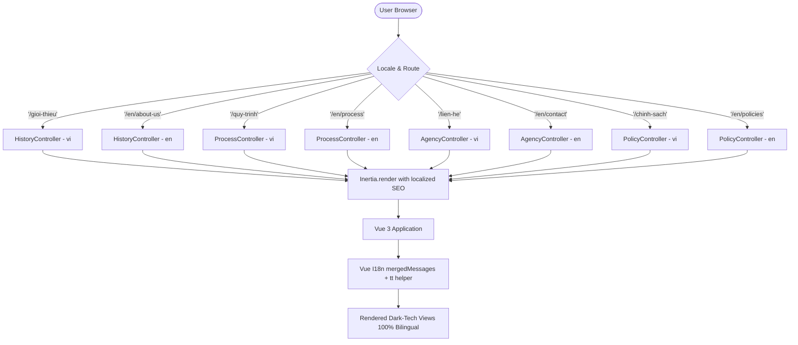

# Design: Kiến Trúc Đa Ngôn Ngữ Song Ngữ 100% Cho 4 Trang Thông Tin (About, Process, Contact, Policies)

## 1. Tổng Quan Kiến Trúc
Hệ thống đa ngôn ngữ cho 4 trang thông tin vận hành dựa trên cơ chế Vue I18n tích hợp trong ứng dụng SPA Inertia.js, kết nối với dữ liệu từ điển tập trung từ Laravel backend (`resources/lang/{vi,en}/ui.php`) và hệ thống định tuyến Ziggy có tiền tố locale.

## 2. Chi Tiết Triển Khai

### 2.1. Quản lý Từ điển UI Song Ngữ (`resources/lang/{vi,en}/ui.php`)
- Mọi chuỗi giao diện tĩnh trên 4 trang được định nghĩa theo cặp:
  - Khóa: Bản văn bản tiếng Việt nguyên bản (hoặc semantic token).
  - Giá trị: Bản dịch tương ứng (tiếng Việt tại `vi/ui.php`, tiếng Anh chuẩn kỹ thuật tại `en/ui.php`).
- Sinh lại tệp bundle dịch thuật:
  `php artisan vue-i18n:generate` -> tạo `public/build/locales/i18n.js`.

### 2.2. Song ngữ hóa Trang Giới thiệu (`About/Index.vue`)
- `Head`: Sử dụng `tt(...)` cho tiêu đề và thẻ meta description.
- Hero fallback: Các computed properties `bannerSubtitle`, `bannerTitle`, `bannerDescription` bọc `tt(...)`.
- Lý do khởi đầu sứ mệnh: Toàn bộ tiêu đề và nội dung đoạn văn được wrap qua `tt(...)`.
- Chia sẻ Founder: Lời tâm sự và câu trích dẫn triết lý dùng `tt(...)`.
- 3 Thẻ giá trị chế tác: Tiêu đề thẻ và mô tả được wrap qua `tt(...)`.
- CTA kết nối: Computed `ctaTitle`, `ctaDescription`, `ctaButtonText` sử dụng `tt(...)`.

### 2.3. Song ngữ hóa Trang Quy trình (`Process/Index.vue` & Components)
- `Process/Index.vue`:
  - `pageTitle` & `pageDescription` được tính toán reactive theo locale hoặc `tt(...)`.
  - Mảng `processSteps`: Các trường `title`, `description`, `clientPrep`, `makerAction` bọc `tt(...)`.
- `ProcessHero.vue`:
  - Computed `categoryText`, `headlineText`, `descriptionText`, `ctaText` bọc `tt(...)`.
- `ProcessStepper.vue`:
  - Mảng `steps`: Tiêu đề các bước bọc `tt(...)`.
- `ProcessStepItem.vue`:
  - Nhãn 2 cột "BẠN CHUẨN BỊ" và "HH MAKER THỰC HIỆN" bọc `tt(...)`.
- `ProcessFaq.vue`:
  - Tiêu đề mục "CÂU HỎI THƯỜNG GẶP", phụ đề "Giải đáp trước khi liên hệ", câu hỏi và câu trả lời trong mảng `faqs` bọc `tt(...)`.

### 2.4. Song ngữ hóa Trang Liên hệ (`Contact.vue`)
- `Head`: Localized title & description.
- Hero banner: Tiêu đề và mô tả bọc `tt(...)`.
- 3 Thẻ kênh liên hệ: Tiêu đề và mô tả bọc `tt(...)`.
- Form tư vấn 6 trường:
  - Labels và placeholders: `tt(...)`.
  - Mảng `availableServices`: Ánh xạ các dịch vụ ['Thiết kế 3D', 'Gia công 3D', 'Làm đồ custom'].
  - Nút submit: "Gửi yêu cầu tư vấn" / "Đang gửi yêu cầu...".
  - Validation: Các câu cảnh báo `clientErrors` hiển thị theo ngôn ngữ hiện tại.
- Modal thành công: Tiêu đề, thông điệp và nút đóng bọc `tt(...)`.
- FAQ: Toàn bộ danh sách câu hỏi và câu trả lời bọc `tt(...)`.

### 2.5. Song ngữ hóa & Hiện đại hóa Trang Chính sách (`Policy.vue`)
- Hiện đại hóa giao diện theo ngôn ngữ thiết kế dark-tech của HH Maker:
  - Nền `#111322`, card kính mờ `bg-white/5` viền `border-[#5D6B98]`, chữ trắng `#FAFAFA` và `#B9C0D4`.
- Sidebar điều khoản:
  - Bọc `tt(...)` cho tiêu đề các chính sách (Terms of Service, Privacy Policy, Warranty Policy).
- Dữ liệu dự phòng (Fallback Data):
  - Khi cơ sở dữ liệu chưa có chính sách, `PolicyController` cung cấp bộ 3 chính sách cốt lõi chuẩn song ngữ.

### 2.6. Localized SEO trong Controllers
- `HistoryController`: Truyền viewData `seo` với tiêu đề và mô tả tiếng Anh hoặc tiếng Việt theo `current_locale()`.
- `AgencyController`: Truyền viewData `seo` với tiêu đề và mô tả song ngữ.
- `ProcessController`: Bổ sung viewData `seo` song ngữ.
- `PolicyController`: Truyền viewData `seo` song ngữ.

### 2.7. Chiến lược Kiểm thử Playwright E2E
- Kiểm thử điều hướng và tính hiển thị 100% tiếng Anh cho cả 4 route `/en/about-us`, `/en/process`, `/en/contact`, `/en/policies`.
- Chụp ảnh màn hình lưu trữ tại `tests/e2e/screenshots/`.
