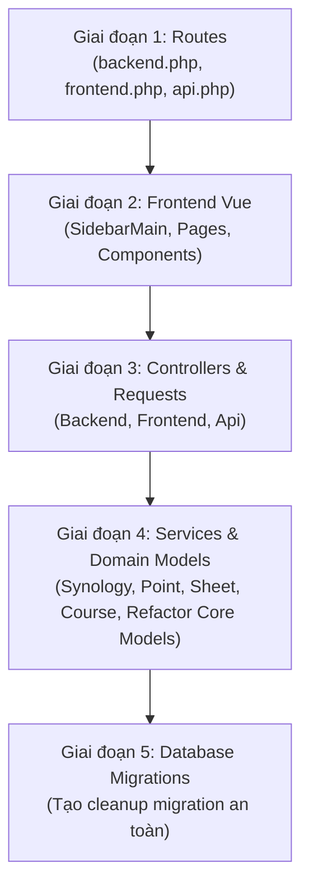

# Design: Bóc tách Module FunkyStyle và Chuẩn hóa Base CMS

## Context
Dự án Saigonchem được khởi tạo dựa trên mã nguồn FunkyStyle (một nền tảng quản lý đào tạo đồ họa / âm nhạc và bán tài nguyên số). Sau thời gian phát triển trước đây, các tính năng đặc thù của FunkyStyle như Khóa học, Lớp học, Điểm Quả thưởng, Hạng thành viên, Tích hợp NAS Synology tải tài nguyên, Thanh toán học phí (SePay/PayPal) và Đồng bộ Google Sheets nằm rải rác từ tầng Routing, Navigation Frontend (Inertia/Vue), Controllers, Services, Eloquent Models cho đến Cấu trúc Database.

Để chuyển đổi thành công sang dự án Saigonchem (website thương mại hóa chất & phụ gia công nghiệp), hệ thống cần một bản thiết kế bóc tách theo thứ tự phụ thuộc (dependency order) ngược, đảm bảo việc loại bỏ mã nguồn diễn ra an toàn, không phát sinh lỗi 500 runtime do gọi model/relation đã mất, không vỡ build asset của Vite, và không làm hỏng dữ liệu Base CMS.

Xem thêm [proposal.md](proposal.md) về mục tiêu và [spec.md](specs/clean-architecture/spec.md) về các ràng buộc hành vi của hệ thống sau khi dọn dẹp.

## Goals / Non-Goals

**Goals:**
- Xác lập thứ tự gỡ bỏ dependency chặt chẽ: `Routes -> Frontend Vue & Menu -> Controllers -> Services & Core Models -> Database Migrations`.
- Định hình phương án xử lý cơ sở dữ liệu an toàn (Safe Database Cleanup) không gây gián đoạn migration lịch sử.
- Đảm bảo các module cốt lõi của Base CMS (Quản trị Admin, Phân quyền, Tin tức, Sản phẩm, Liên hệ, Media, Cấu hình, Đa ngôn ngữ) hoạt động ổn định 100%.
- Cung cấp checklist kiểm tra hồi quy toàn diện trước và sau khi thực thi.

**Non-Goals:**
- Không thiết kế lại giao diện nhận diện thương hiệu của Saigonchem trong change này (sẽ có change riêng cho theme/UI Saigonchem).
- Không sửa đổi trực tiếp các file migration cũ trong thư mục `database/migrations` (bảo toàn lịch sử git & migrate).
- Không thêm mới các trường đặc thù hóa chất (CAS number, COA/MSDS documents) vào Model Product trong change này.

## Decisions

### Decision 1: Thứ tự gỡ bỏ dependency từ ngoài vào trong
Để tránh tình trạng "gãy liên kết" (broken references) khi thực thi, quá trình loại bỏ mã nguồn BẮT BUỘC tuân theo 5 giai đoạn:

1. **Giai đoạn 1: Đóng Routing (Tầng biên)**:
   - Xóa bỏ các khai báo route liên quan đến Course, Class, School, Point, UserRank, Resource, Synology, GoogleSheet, SePay/PayPal trong `routes/backend.php`, `routes/frontend.php`, và `routes/api.php`.
   - *Lý do*: Ngắt ngay lập tức mọi luồng truy cập và webhook từ bên ngoài trước khi xóa logic bên trong.
2. **Giai đoạn 2: Dọn dẹp Frontend Vue & Navigation**:
   - Loại bỏ các mục menu trong `resources/Backend/js/Components/SidebarMain.vue`.
   - Xóa các thư mục view Backend: `Courses/`, `CourseClasses/`, `CourseCategories/`, `Combos/`, `Schools/`, `StudentProfile/`, `StudentRevenue/`, `PointPackages/`, `PointTransactions/`, `UserRanks/`, `GoogleSheetImport/`, `GoogleSheetOrderSync/`, `Resources/`, `ResouceCategories/`, `ContactCheckoutCourse/`, `FormCheckoutCourse/`, `FormCheckoutResource/`.
   - Xóa các view Frontend: `Courses.vue`, `CourseDetail.vue`, `Courses/`, `Resources.vue`, `Resources/`, `Checkout/`, `Closed.vue`.
   - Dọn sạch các import và liên kết trong các component dùng chung (Header, Footer, MobileNav).
   - *Lý do*: Đảm bảo Vite compile không bị lỗi `Module not found` hoặc `route() not defined`.
3. **Giai đoạn 3: Gỡ bỏ Controllers & Form Requests**:
   - Xóa bỏ toàn bộ controller đặc thù trong `app/Http/Controllers/Backend`, `Frontend`, và `Api`.
   - *Lý do*: Tầng tiếp nhận request không còn cần thiết sau khi route và view đã được bóc tách.
4. **Giai đoạn 4: Gỡ bỏ Services và Refactor Core Models**:
   - Xóa các service: `ClassAllocationService`, `ContactWorkflowService`, `CourseClassOrderingService`, `CourseConfirmationSlipService`, `GoogleSheetService`, `GoogleSheetSyncService`, `PayPalService`, `PointService`, `SePayService`, `SynologyService`, `VNPayService`.
   - Xóa các model đặc thù: `CourseClass`, `CourseConfirmationSlip`, `Combo`, `ComboCourse`, `School`, `PointPackage`, `PointTransaction`, `UserRank`, `GoogleSheetSyncLog`.
   - Refactor các core model:
     + `Product.php`: Gỡ bỏ quan hệ `courses()`, `saveCourses()`, và scope lọc khóa học.
     + `Post.php`: Gỡ bỏ `TYPE_COURSE`, `TYPE_RESOURCE`, `TYPE_RESOURCE_FREE`, `TYPE_RESOURCE_PAY`, `points_cost`, `download_count`.
     + `User.php`: Gỡ bỏ các hàm cộng/trừ điểm thưởng, quan hệ `userRank()`, các trường `points`, `lifetime_points`, `reward_locked`.
     + `Contact.php`: Gỡ bỏ logic phân bổ lớp học, trạng thái checkout khóa học/tài nguyên.
5. **Giai đoạn 5: Xử lý Cơ sở dữ liệu (Clean Database Migration)**:
   - Viết migration mới để drop các bảng và cột thừa.

### Decision 2: Phương án xử lý bảng dữ liệu an toàn (Safe Database Cleanup)
- **Không chỉnh sửa migration cũ**: Các migration cũ từ năm 2023 - 2026 trong `database/migrations` đại diện cho lịch sử git và trạng thái đã deploy của DB. Việc sửa trực tiếp file cũ sẽ gây xung đột schema trên các máy dev khác hoặc môi trường staging/production.
- **Tạo migration dọn dẹp mới**: Tạo file migration chuyên biệt, ví dụ `2026_10_05_000000_cleanup_funkystyle_legacy_tables_and_columns.php`.
- **Ràng buộc an toàn trong Migration**:
  + Tắt kiểm tra khóa ngoại tạm thời trước khi drop bảng: `Schema::disableForeignKeyConstraints()`.
  + Kiểm tra `Schema::hasTable(...)` trước khi gọi `Schema::dropIfExists(...)`.
  + Kiểm tra `Schema::hasColumn(...)` trước khi gọi `dropColumn(...)` trên các bảng `users`, `contacts`, `posts`.
  + Bật lại khóa ngoại: `Schema::enableForeignKeyConstraints()`.
  + Triển khai phương thức `down()` có rollback tương ứng (hoặc ghi rõ log trạng thái).

### Decision 3: Bảo toàn và chuẩn hóa Base CMS
- Giữ nguyên kiến trúc chuẩn:
  + Base Controller & Base Model: kế thừa đầy đủ tính năng localization và helper CMS.
  + Module Sản phẩm (`Product`, `ProductCategory`, `ProductVariant`): Làm sạch khỏi các liên kết khóa học, giữ nguyên cấu trúc biến thể, giá bán, mã hàng để sẵn sàng tích hợp sản phẩm hóa chất Saigonchem.
  + Module Bài viết (`Post`, `PostCategory`, `Tag`): Giữ nguyên để phục vụ tin tức ngành hóa chất, bài viết kỹ thuật và tài liệu sản phẩm.
  + Media (`File`, `Gallery`, `Slider`): Giữ nguyên phục vụ lưu trữ hình ảnh catalog, chứng chỉ hóa chất (COA, MSDS).

## Risks / Trade-offs

| Rủi ro (Risk) | Khả năng xảy ra | Tác động | Biện pháp giảm thiểu (Mitigation) |
| :--- | :--- | :--- | :--- |
| **Foreign Key Constraint Crash** khi drop bảng | Trung bình | Cao | Tắt foreign key check trong migration (`Schema::disableForeignKeyConstraints()`), drop bảng phụ thuộc trước (`combo_course`, `course_confirmation_slips`) rồi mới đến bảng chính (`combos`, `schools`). |
| **Vite Compile Failure** do sót component import | Cao | Cao | Tìm kiếm toàn diện (grep) tất cả các import `Course`, `Point`, `Resource` trong `resources/Backend` và `resources/Frontend` trước khi chạy `npm run build`. |
| **Lỗi 500 Route Not Found** trong Sidebar/Header | Cao | Nghiêm trọng | Rà soát `SidebarMain.vue`, `Header.vue`, `Footer.vue`, thay thế hoặc xóa bỏ hoàn toàn các directive `route('admin.courses.*')`, `route('admin.point-*')`. |
| **Quan hệ Eager Loading mồ côi** trong core model queries | Trung bình | Nghiêm trọng | Rà soát toàn bộ `with(['courses', 'userRank'])` trong các controller còn lại như `UserController`, `ProductController`, `ContactController`. |
| **Mất mát dữ liệu ngoài ý muốn** | Thấp | Rất nghiêm trọng | Sao lưu toàn bộ Database trước khi chạy migration dọn dẹp. |

## Migration Plan & Implementation Checklist

### 1. Pre-Implementation Checklist
- [ ] Sao lưu toàn bộ Database hiện tại (dump SQL).
- [ ] Tạo nhánh git riêng biệt (ví dụ `feature/strip-funkystyle-clean-cms`).
- [ ] Kiểm tra trạng thái hiện tại: `php artisan test` và `npm run build` đang hoạt động bình thường.

### 2. Implementation Order Checklist
- [ ] **Giai đoạn 1: Routes**:
  - [ ] Dọn `routes/backend.php` (loại bỏ routes của 5 nhóm module).
  - [ ] Dọn `routes/frontend.php` (loại bỏ routes public của courses, resources, slips, checkout).
  - [ ] Dọn `routes/api.php` (loại bỏ webhooks SePay, PayPal, Academic options, Course endpoints).
- [ ] **Giai đoạn 2: Frontend (Inertia/Vue)**:
  - [ ] Cập nhật `SidebarMain.vue` (xóa bỏ toàn bộ menu items FunkyStyle).
  - [ ] Xóa các folder/file trang trong `resources/Backend/js/Pages/`.
  - [ ] Xóa các folder/file trang trong `resources/Frontend/js/Pages/`.
  - [ ] Dọn dẹp component dùng chung (Navbar, Footer, Mobile Menu).
- [ ] **Giai đoạn 3: Controllers**:
  - [ ] Xóa các file Controller Backend đặc thù.
  - [ ] Xóa các file Controller Frontend đặc thù.
  - [ ] Xóa các file Controller Api đặc thù (`ComboController`, `SePayWebhookController`, v.v.).
- [ ] **Giai đoạn 4: Services & Core Models**:
  - [ ] Xóa 11 services nghiệp vụ FunkyStyle.
  - [ ] Xóa các Models đặc thù.
  - [ ] Refactor `Product.php`, `Post.php`, `User.php`, `Contact.php`.
- [ ] **Giai đoạn 5: Database Cleanup Migration**:
  - [ ] Tạo file migration `cleanup_funkystyle_legacy_tables_and_columns`.
  - [ ] Drop các bảng: `course_classes`, `course_confirmation_slips`, `combos`, `combo_course`, `schools`, `point_packages`, `point_transactions`, `user_ranks`, `google_sheet_sync_logs`.
  - [ ] Drop các cột thừa trên `users`, `contacts`, `posts`.

### 3. Post-Implementation Verification Checklist
- [ ] Chạy `composer dump-autoload` không có lỗi class missing.
- [ ] Chạy `php artisan route:list` không còn route FunkyStyle nào và không vỡ closure.
- [ ] Chạy `npm run build` (hoặc build Vite) thành công 100%, không thiếu module/asset.
- [ ] Truy cập Admin Dashboard `/admin/dashboard` thành công, menu hiển thị đúng các chức năng Base CMS.
- [ ] Truy cập Public Home `/`, `/posts`, `/products` thành công, không phát sinh lỗi 500/404 bất thường.
