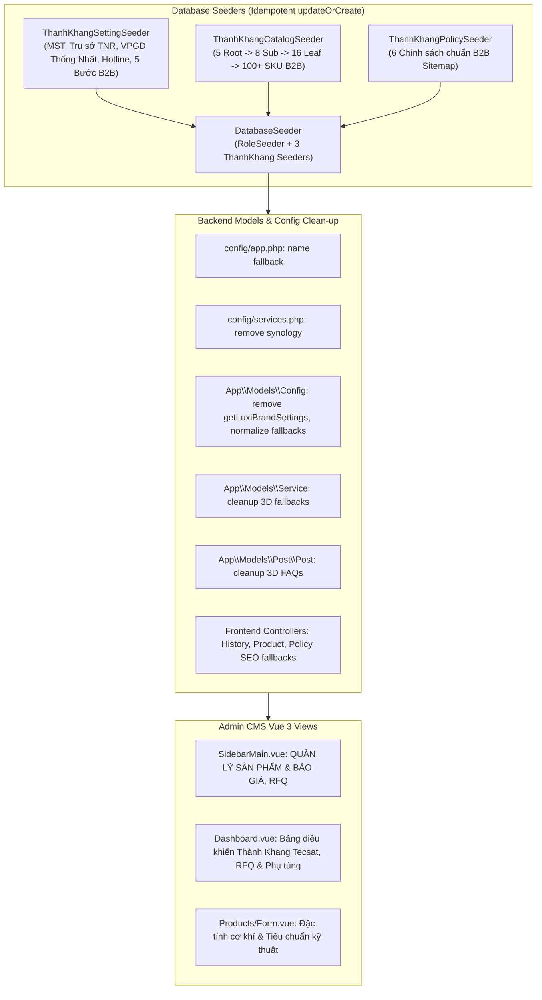

# Design: Triển khai Seeders chuẩn B2B Thành Khang Tecsat & Dọn dẹp tàn dư CMS/Backend

## Architecture Overview



## 1. Danh mục 3 tầng & Cấu trúc Sản phẩm (Hierarchy & Data Model)

### Cây danh mục 3 tầng:
```
Root 01: Linh kiện thang cuốn (linh-kien-thang-cuon)
  ├── Sub 01: Tay vịn thang cuốn (tay-vin-thang-cuon)
  │     ├── Leaf 01: Tay vịn cao su tiêu chuẩn (tay-vin-tieu-chuan)
  │     └── Leaf 02: Tay vịn màu & kháng khuẩn (tay-vin-mau-khang-khuan)
  ├── Sub 02: Xích thang cuốn (xich-thang-cuon)
  │     ├── Leaf 03: Xích bậc thang cuốn tải nặng (xich-bac-thang-cuon)
  │     └── Leaf 04: Xích truyền động tay vịn (xich-truyen-dong-thang-cuon)
  └── Sub 03: Bánh xe thang cuốn (banh-xe-thang-cuon)
        ├── Leaf 05: Con lăn bậc thang Step Roller (con-lan-bac-thang)
        └── Leaf 06: Con lăn xích & dẫn hướng (con-lan-xich-dan-huong)

Root 02: Linh kiện thang nâng ô tô (linh-kien-thang-nang-o-to)
  └── Sub 04: Xích bãi đỗ xe & nâng hạ ô tô (xich-bai-do-xe)
        ├── Leaf 07: Xích lá tải trọng lớn Leaf Chain (xich-la-nang-ha-o-to)
        └── Leaf 08: Xích con lăn hệ thống đỗ xe tự động (xich-con-lan-he-thong-do-xe)

Root 03: Hệ thống băng tải hành lý (he-thong-bang-tai-hanh-ly)
  └── Sub 05: Xích băng tải hành lý & logistics (xich-bang-tai-hanh-ly-logistics)
        ├── Leaf 09: Xích băng tải phân loại hành lý sân bay (xich-bang-tai-hanh-ly-san-bay)
        └── Leaf 10: Xích tải hàng kho vận logistics (xich-tai-hang-logistics-kho-van)

Root 04: Linh kiện dây chuyền đóng gói (linh-kien-day-chuyen-dong-goi)
  ├── Sub 06: Xích dây chuyền đóng gói (xich-day-chuyen-dong-goi)
  │     ├── Leaf 11: Xích kẹp màng đóng gói chân không (xich-kep-mang-dong-goi)
  │     └── Leaf 12: Xích tải hộp & thùng carton (xich-tai-hop-thung-carton)
  └── Sub 07: Xích băng tải nhẹ (xich-bang-tai-nhe)
        ├── Leaf 13: Xích tấm Inox & Nhựa Tabletop (xich-tam-inox-nhua)
        └── Leaf 14: Xích con lăn chống ăn mòn thực phẩm (xich-con-lan-chong-an-mon)

Root 05: Giải pháp tiết kiệm điện (giai-phap-tiet-kiem-dien)
  └── Sub 08: Quạt trần công nghiệp BLDC (quat-bldc)
        ├── Leaf 15: Quạt trần công nghiệp HVLS cánh lớn (quat-tran-cong-nghiep-hvls)
        └── Leaf 16: Hệ thống điều khiển & biến tần tiết kiệm điện (he-thong-dieu-khien-tiet-kiem-dien)
```

### Quy chuẩn dữ liệu Sản phẩm:
- `sku`: Mã ký hiệu kỹ thuật công nghiệp chuẩn (ví dụ: `TL133`, `16A-2F`, `LT40-1`, `40SR`, `40HP`, `M20`, `FV40`, `BLDC-7300`...).
- `price`: `null` (Báo giá theo thông số kỹ thuật và số lượng đơn hàng B2B).
- `compare_at_price`: `null`.
- `status`: `'ACTIVE'`.
- `specifications`: Mảng JSON chứa các cặp `{label: "...", value: "..."}` mô tả:
  - Bước xích (Pitch)
  - Tải trọng phá hủy tối thiểu (Min Tensile Strength)
  - Vật liệu chế tạo (Thép 40Cr, Inox 304, Polyurethane chịu mài mòn...)
  - Đường kính con lăn (Roller Diameter)
  - Tiêu chuẩn sản xuất (ISO 606, DIN 8187, ANSI B29.1, JIS B1801...)
  - Xuất xứ / Tiêu chuẩn kiểm định (Đầy đủ CO, CQ)

## 2. Quy trình 5 Bước B2B Thiết bị Công nghiệp
Quy trình được chuẩn hóa cả trong CSDL (`settings.process_steps` & `settings.process_steps_en`) và phương thức `Config::getProcessSteps()`:
1. **01 - Tiếp nhận yêu cầu kỹ thuật (Technical Intake)**: Tiếp nhận mã phụ tùng, bản vẽ kỹ thuật hoặc thông số mẫu.
2. **02 - Khảo sát & Báo giá kỹ thuật (Specs Survey & RFQ Quotation)**: Kỹ sư đối chiếu tiêu chuẩn kỹ thuật và lập bảng báo giá cạnh tranh.
3. **03 - Xác nhận đơn hàng & Hợp đồng cung ứng (Order Confirmation & Contract)**: Ký hợp đồng kinh tế và thống nhất tiến độ giao hàng.
4. **04 - Kiểm định chất lượng (QC) & Đóng gói công nghiệp (QC & Industrial Packaging)**: Kiểm tra nghiêm ngặt kích thước, tải trọng, độ cứng bề mặt và đóng kiện tiêu chuẩn công nghiệp.
5. **05 - Bàn giao, lắp đặt & Bảo hành chính hãng (Handover & Warranty Support)**: Giao hàng tận nơi, cung cấp chứng chỉ CO/CQ và bảo hành chính hãng.

## 3. Hệ thống 6 Chính sách B2B
Tạo mới trong bảng `policies` và `policy_translations` (song ngữ VI/EN):
1. `chinh-sach-ban-hang` / `sales-policy`
2. `chinh-sach-thanh-toan` / `payment-policy`
3. `chinh-sach-van-chuyen` / `shipping-policy`
4. `chinh-sach-doi-tra` / `return-refund-policy`
5. `chinh-sach-bao-hanh` / `warranty-policy`
6. `chinh-sach-bao-mat` / `privacy-policy`

## 4. Safe Guard Policy
- Tuyệt đối không xóa bảng hay chạy lệnh `migrate:fresh`.
- Sử dụng phương thức `updateOrCreate` hoặc `updateOrInsert` kiểm tra theo khóa định danh (`name` + `group` cho settings, `slug` cho danh mục/chính sách/sản phẩm).
- Bảo toàn nguyên vẹn tài khoản quản trị Admin (`admins`, `users`) và dữ liệu form liên hệ hiện có (`contacts`).
